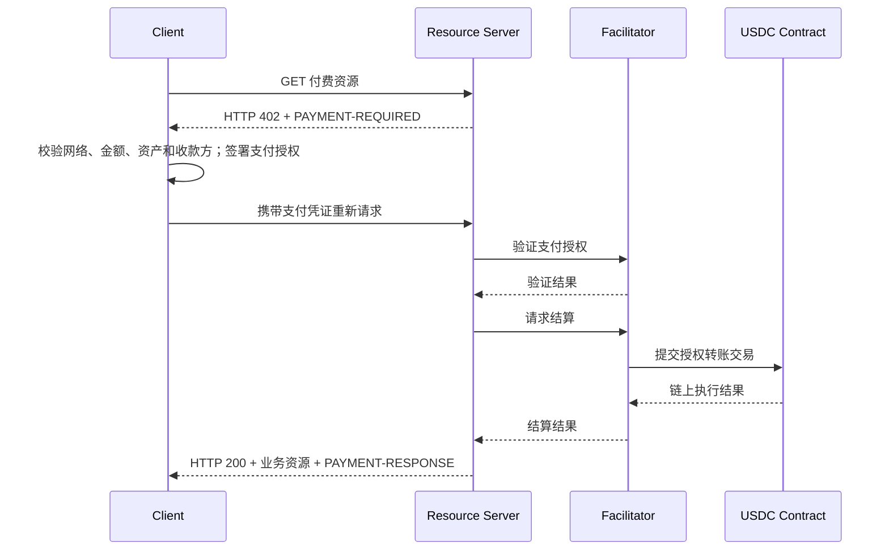
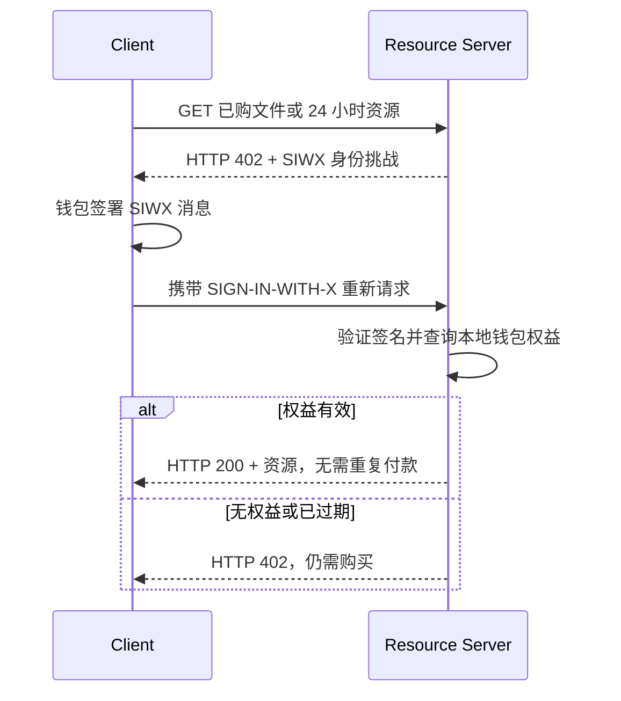

# x402 Payment Flow

基于 TypeScript、Express 和 x402 V2 的 Base Sepolia 测试网支付项目。服务端用官方 x402 中间件保护 HTTP 资源，由公共 Facilitator 验证并结算 USDC 支付。项目固定使用 Base Sepolia 测试 USDC（`eip155:84532`），适合学习和验证支付流程；不提供主网或生产级结算恢复能力。

## 技术栈与环境

- Node.js 22 或更新版、npm、TypeScript 5.9、Express 4、viem 2.57。
- `@x402/core`、`evm`、`express`、`fetch`、`extensions` 均固定为 2.32.0。
- Windows PowerShell；需要访问 Base Sepolia RPC、公共 Facilitator 和 npm 软件包源。
- 服务仅监听本机 `127.0.0.1` 或 `localhost`；默认端口为 `4021`。配置见 [`.env.example`](.env.example)。

## 接口与收费模式

| 方法与路径 | 价格 | 用途和访问方式 |
| --- | ---: | --- |
| `GET /health` | 免费 | 服务健康状态 |
| `GET /api/catalog` | 免费 | 收费资源目录 |
| `GET /api/hello` | 0.01 测试 USDC | 每次请求付费的问候信息 |
| `GET /api/analysis` | 0.01 测试 USDC | 每次请求付费的内置样例数据分析 |
| `GET /api/files/guide.md` | 0.02 测试 USDC | 购买文件后，同一钱包可永久重复获取 |
| `GET /api/pass/24h` | 0.05 测试 USDC | 购买后，同一钱包可在 24 小时内重复访问样例报告 |

分析接口使用内置固定样例数据，不接入真实订单或外部数据源。文件和 24 小时权益保存在本机 `data/siwx-entitlements.json`；“永久”指本地权益记录仍被保留且可读取，并非链上永久凭证。原始 `/api/hello` 付款不会追溯授予其他资源的权益。

## x402 V2 支付流程



客户端在签名前检查 x402 V2 `exact` 报价：链 ID、USDC 合约、金额和 Seller 地址必须符合预期。EIP-3009 通过 EIP-712 签名授权 USDC 合约执行 `transferWithAuthorization`；客户端签署的是代币转账授权，并非直接向 Facilitator 支付 ETH。Facilitator 负责校验授权、提交结算交易并返回结果；服务端根据 x402 中间件的结果交付资源。链上交易状态应以浏览器和余额核验，单独的 HTTP 200 不能代替链上确认。

## SIWX 钱包身份与重复访问

已购买文件或 24 小时权益的钱包可通过 SIWX（Sign-In-With-X）证明地址控制权。服务端查询该地址与资源对应的本地权益，并记录已用 nonce；`read-*` 命令只签身份消息，不创建付款。`buy-file` 和 `buy-pass` 也会先尝试 SIWX，权益有效时直接读取。



Payment-Identifier 用于把客户端的一次支付尝试与服务端结算日志关联，方便排查。它不是钱包所有权证明，也没有实现完整的支付幂等、自动重试保护或生产级“恰好一次”结算。服务端不会仅凭 Payment-Identifier 授予访问权。

## Windows PowerShell 本地运行

在项目目录中运行：

```powershell
node -v
npm install
```

首次使用且**尚无 `.env`** 时，运行 `npm run wallets:init` 生成 BUYER 和 SELLER 测试钱包。命令只显示公开地址，写入本机 `.env`，并会拒绝覆盖已有 `.env`。已有钱包的用户直接沿用原文件，勿重新生成。

```powershell
npm run wallets:init
npm run balance
```

向 BUYER **公开地址**领取 Base Sepolia 测试 USDC，可使用 [Circle 测试币水龙头](https://faucet.circle.com/)；领取限制以水龙头页面为准。确认链是 Base Sepolia、USDC 合约为 `0x036CbD53842c5426634e7929541eC2318f3dCF7e`。不要向水龙头输入私钥，也不要向这些测试钱包转入真实资产。`npm run balance` 可查看两钱包的测试 USDC 余额。

在 PowerShell 窗口 A 启动服务：

```powershell
npm run server
```

在窗口 B 先运行免费或只读检查：

```powershell
Invoke-RestMethod http://127.0.0.1:4021/health
npm run probe
npm run lab:catalog
npm run lab:probe
npm run lab:read:file
npm run lab:read:pass
```

`probe` 检查 `/api/hello` 的 402 报价；`lab:probe` 检查三个新增收费接口。`read-*` 会使用现有 BUYER 钱包签署 SIWX 身份消息，若尚无权益则仍返回 402；这些命令不会发起支付。

以下命令会**实际授权 Base Sepolia 测试 USDC 支付**。请在确认报价、余额和网络后按需逐条执行：

```powershell
npm run pay
npm run lab:buy:file
npm run lab:read:file
npm run lab:buy:pass
npm run lab:read:pass
npm run lab:buy:analysis
npm run balance
```

`pay` 购买一次 `/api/hello`；`buy-analysis` 每次运行均可能再支付 0.01 测试 USDC。`buy-file` 成功后把文件保存到 `downloads/x402-field-guide.md`；已购钱包再次运行 `read-file` 或 `buy-file` 时可通过 SIWX 免付费获取。`buy-pass` 的权益从最近一次成功结算起持续 24 小时，服务端重启后仍从本地文件恢复；到期后需要再次购买。窗口 A 用 `Ctrl+C` 停止服务。

## Base Sepolia 测试网交易记录

以下四笔由已完成的测试网验收提供，哈希格式均已核对；Blockscout API 查询到四笔成功的 `transferWithAuthorization` 交易，USDC 转账金额与接口价格一致。所有交易均发生在 Base Sepolia 测试网，测试 USDC 没有真实货币价值。

| 测试场景 | 支付金额 | 交易哈希 | Blockscout |
| --- | ---: | --- | --- |
| 原始 Hello | 0.01 测试 USDC | `0x966fb6dc…737053b4` | [查看交易](https://base-sepolia.blockscout.com/tx/0x966fb6dca15f926910b3d2e45d580e5114b79df37a32046187938a88737053b4) |
| 文件购买 | 0.02 测试 USDC | `0x5af55351…1d4de656` | [查看交易](https://base-sepolia.blockscout.com/tx/0x5af5535143422393cdb498f90ff7b3c4fa8a59f54ede13872eaf83881d4de656) |
| 24 小时访问 | 0.05 测试 USDC | `0xdca259f1…fca03e1d` | [查看交易](https://base-sepolia.blockscout.com/tx/0xdca259f1249a69bd7876a6b297844725691a9054f56c7d55ce82f02bfca03e1d) |
| 数据分析 | 0.01 测试 USDC | `0x321a0bb6…970f406f` | [查看交易](https://base-sepolia.blockscout.com/tx/0x321a0bb64476dd86a5313cc04fe5069a13522d34d197dbfb34c9cafe970f406f) |

已完成的 Windows 测试网验收还包括：原始支付、付费文件下载、SIWX 重复访问、服务端重启后权益恢复、24 小时权益购买及重复访问、数据分析接口真实支付。24 小时**自然到期后的实时验收尚未进行**；到期分支由自动化测试覆盖。

## 项目结构

```text
src/
  server.ts           HTTP 接口、x402 中间件及 Facilitator
  catalog.ts          资源目录、价格和样例分析
  entitlements.ts     SIWX 权益和 nonce 的本地持久化
  lab-client.ts       目录、探测、SIWX 读取与购买命令
  payment-offer.ts    402 报价与结算响应解析
  config.ts           本机与测试网配置校验
  constants.ts        链、USDC 合约与原始接口价格
  init-wallets.ts     首次生成测试钱包
  pay.ts              原始 Hello 购买命令
  probe.ts            原始 Hello 免费探测
  balance.ts          测试 USDC 余额查询
tests/                报价、目录和权益单元测试
assets/field-guide.md 付费下载的样例文件
data/                 本地权益状态（忽略 Git）
downloads/            下载结果（忽略 Git）
```

## 工程检查

```powershell
npm run typecheck
npm run test
npm run build
```

## 超时与安全边界

- 支付请求超时、断线或收到不明确的结算响应时，支付状态可能未知。先查询 Blockscout 交易与两钱包余额；文件和 24 小时权益可再用 `read-*` 检查。不要立即重复执行付款命令。
- 本地权益文件若丢失、损坏或结算后写入失败，链上交易不会自动恢复为本地权益；需要人工核对。该单进程文件存储不提供分布式锁、退款或生产级结算恢复。
- 搬迁或恢复项目时保留原有 `.env` 和 `data/siwx-entitlements.json`；回滚代码或文件不会撤销已发生的链上交易。
- `.env` 含本地测试私钥；`data/` 含购买权益和 SIWX nonce；`downloads/` 含下载结果。它们均被 `.gitignore` 排除。不要分享、提交或上传这些文件，也不要把私钥粘贴到浏览器或问题报告中。
- 项目只用于 Base Sepolia 测试和流程学习。第三方 npm 依赖遵循各自许可证；项目许可见 [LICENSE](LICENSE)。
